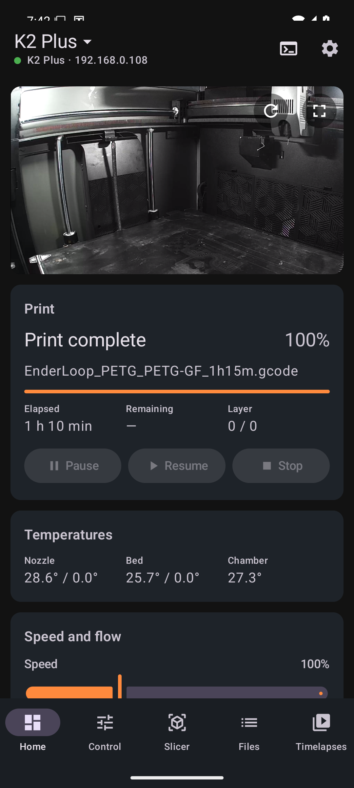
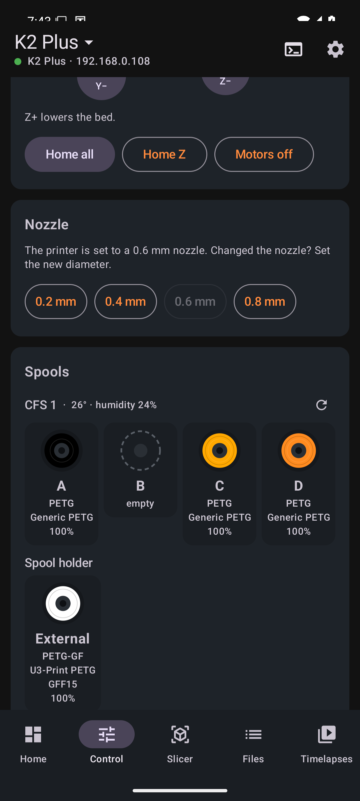
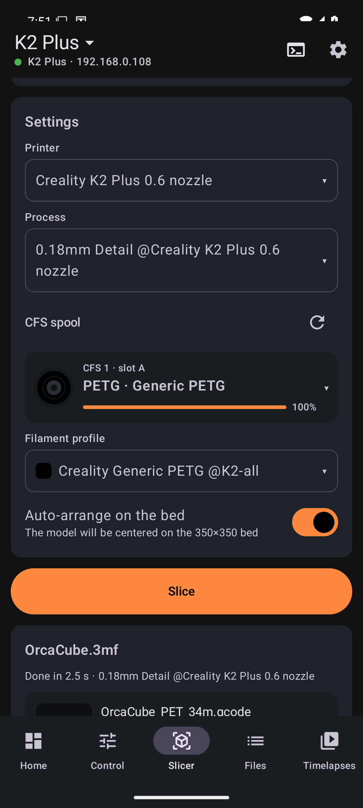
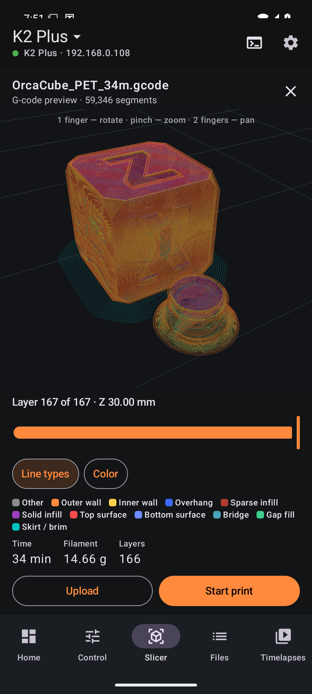
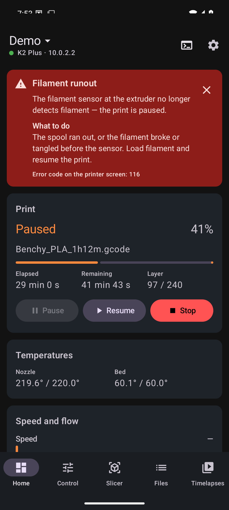

# Filum

**Control Creality OS printers from your phone, and slice on your own server.**

Filum is an Android app for Creality printers that run Creality OS (Klipper + Moonraker): K2 series, K1 series,
Ender-3 V3 series, Creality Hi. It works over your local network with no cloud account. It comes with an optional
**Filum Slicer** server: OrcaSlicer in a Docker container, so you can slice STL/3MF models, including multicolor CFS
prints, straight from the phone.

[Русская версия](README.ru.md)

| Home | Control | Slicer | G-code preview | Error explained |
|---|---|---|---|---|
|  |  |  |  |  |

## Features

- **Live camera.** WebRTC or MJPEG is picked automatically by printer model; go2rtc and custom URLs also work.
- **Print status and control.** Progress, layer, time left, pause, resume and stop, speed and flow.
- **Temperatures and fans.** Nozzle, bed and chamber heaters with presets. Part, side and chamber fans and the light.
  The app shows only the controls your printer actually has.
- **Motion and extruder.** Jogging, homing and extrude/retract are blocked while printing. You can also set the
  nozzle diameter.
- **CFS (Creality Filament System).**
  - Boxes and spools with real colors, remaining filament and humidity.
  - Edit any slot or the external spool holder using the printer's own material library.
  - **RFID tags.** Write MIFARE Classic tags for any spool, so the CFS recognizes it like a Creality spool
    ([how](docs/rfid.md)).
- **Printer errors explained.** Filament runout, CFS jams, AI camera detections, heater faults and more come with
  "what happened / what to do". Creality reports many of these as a plain pause, so other apps just say "Paused".
- **Notifications.** A progress notification while printing, plus alerts when a print finishes and when an error
  happens, even with the app closed.
- **Files and timelapses.** Start G-code files on the printer. Watch and download the firmware's timelapse videos.
- **Several printers.** Save several printers and switch between them in one tap.
- **G-code console.**
- **Plugins.** JavaScript plugins can change the commands, slicing requests and G-code the app sends,
  block prints, react to print events and add their own controls ([API](docs/plugins.md)). A plugin can also be a
  driver for another machine: [filum-cnc-pi](https://github.com/fu1se/filum-cnc-pi) adds a GRBL CNC that is
  selected like a printer.
- **Languages:** English and Russian. Android 13+ lets you choose per app.
- **Light and dark theme**, or follow the system (⚙ → Theme).

**Slicer tab (needs Filum Slicer):**
- Models from the phone, from "Share" in other apps, or from MakerWorld.
- OrcaSlicer system profiles, or your own presets synced through orca-sync.
- **Multicolor.** Each model color gets a CFS spool, auto-matched by color and material. The mapping is written into
  the G-code, so the file prints with those spools wherever you start it.
- 3D preview of the model and of the sliced toolpaths, layer by layer.
- Upload to the printer or start the print right away.

## Supported printers

| Printer | Status |
|---|---|
| K2 Plus | Tested daily |
| K2, K2 Pro | Same firmware family as K2 Plus — expected to work |
| K1, K1C, K1 Max, K1 SE | Expected to work* |
| Ender-3 V3, V3 KE, V3 Plus | Expected to work* |
| Creality Hi | Expected to work* |

\* The app talks to **Moonraker on port 7125**. K2-series printers ship with it. On K1 and Ender-3 V3 printers you
usually need to enable root and install Moonraker, for example with the
[Creality Helper Script](https://github.com/Guilouz/Creality-Helper-Script). Camera, timelapses, CFS and error
codes come from the stock Creality services, which every model has. Reports from other models are very welcome;
please open an issue.

## Components

| Directory | What it is |
|---|---|
| [`android/`](android) | The Filum app (Kotlin, Jetpack Compose) |
| [`slicer-server/`](slicer-server) | Filum Slicer: OrcaSlicer CLI behind an HTTP API, plus a small web UI. Docker, TrueNAS, any Linux x86-64 |
| [`printer/material-sync/`](printer/material-sync) | Optional service on the printer: adds your orca-sync filaments to the printer's material library |
| [`docs/`](docs) | Documentation |

```
 Phone (Filum) ──ws:7125──▶ Printer: Moonraker / Klipper        (status, control, files)
       │        ──ws:9999──▶ Printer: Creality services         (CFS, materials, errors, timelapses)
       │        ──:8000 / :8080──▶ Printer camera (WebRTC / MJPEG)
       │
       └──http:8090──▶ Filum Slicer (Docker) ──▶ OrcaSlicer CLI
                           ├─ presets ◀── OrcaSlicer profiles, optional orca-sync
                           ├─ models  ◀── upload / MakerWorld
                           └─ G-code  ──▶ Moonraker of the chosen printer
```

## Quick start

1. **App.** Download the APK from [Releases](../../releases) and install it, or [build it](docs/building.md).
   On first start, enter the printer's IP. You'll find it on the printer screen under Settings → Network.
2. **Slicer (optional).** On any x86-64 machine with Docker, run:
   ```sh
   cd slicer-server && docker compose up -d --build
   ```
   Then enter `http://<server-ip>:8090` in the app settings. For TrueNAS and other setups, see
   [docs/slicer-server.md](docs/slicer-server.md).

## Documentation

- [App guide](docs/app.md): screens, settings, notifications, multiple printers
- [Slicer server](docs/slicer-server.md): installation, configuration, API
- [How Creality OS works](docs/creality-protocol.md): Moonraker and the Creality WebSocket (:9999), CFS, error
  codes. Useful if you build your own tools.
- [Plugins](docs/plugins.md): writing plugins, API reference
- [RFID tags for spools](docs/rfid.md): writing tags, tag format
- [material-sync](printer/material-sync/README.md): your filaments in the printer's library
- [Building and contributing](docs/building.md)
- [Troubleshooting](docs/troubleshooting.md)

## Disclaimer

Filum is an independent project. It is not affiliated with, endorsed by, or supported by Creality. "Creality",
"K1", "K2", "CFS" and related names are trademarks of their owners and are used here only to describe
compatibility. The Creality protocol details come from observing the stock firmware and may change with firmware
updates. Commands sent to a printer can move it and heat it: use the app as you would use the printer's own
screen.

## License

[MIT](LICENSE). The slicer server image downloads [OrcaSlicer](https://github.com/OrcaSlicer/OrcaSlicer), which is
licensed under AGPL-3.0.
