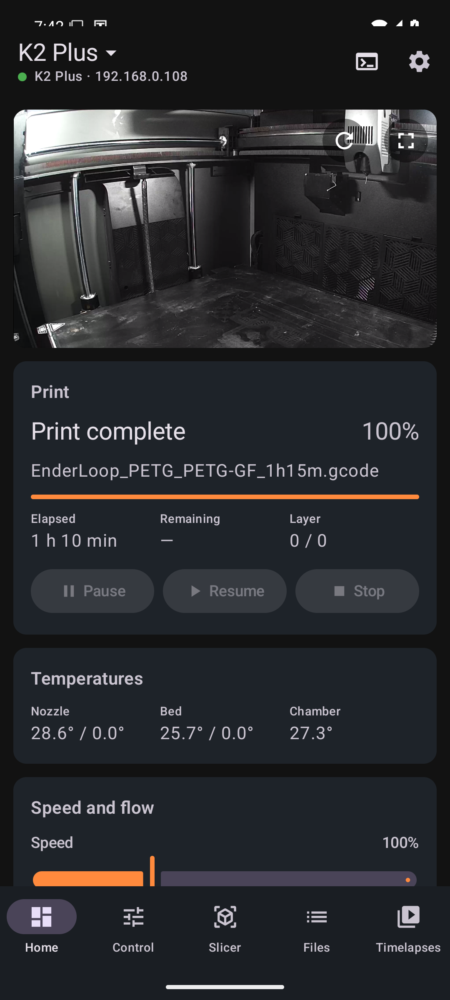
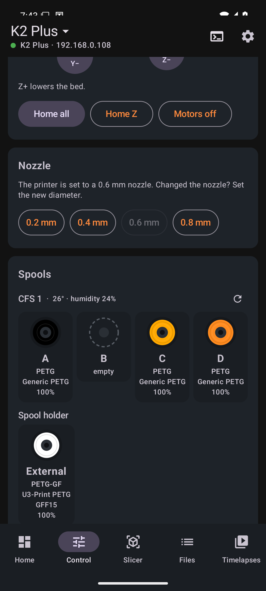
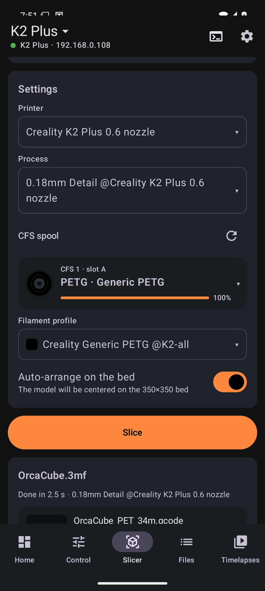
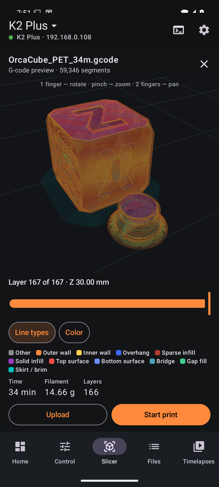
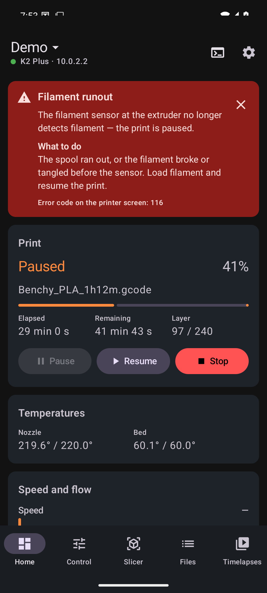

# Filum

**Управление принтерами на Creality OS с телефона и нарезка моделей на своём сервере.**

Filum — Android-приложение для принтеров Creality на Creality OS (Klipper + Moonraker): K2, K1, Ender-3 V3,
Creality Hi. Работает в локальной сети, без облачного аккаунта. К нему есть необязательный сервер
**Filum Slicer** — OrcaSlicer в Docker-контейнере. С ним модели STL/3MF, в том числе многоцветные для CFS,
нарезаются прямо с телефона.

[English version](README.md)

| Главная | Управление | Слайсер | Предпросмотр G-code | Пояснение ошибки |
|---|---|---|---|---|
|  |  |  |  |  |

## Возможности

- **Камера.** WebRTC или MJPEG выбирается автоматически по модели принтера; поддерживаются go2rtc и свой адрес.
- **Печать.** Прогресс, слой, оставшееся время, пауза, продолжение, остановка, скорость и поток.
- **Нагрев и вентиляторы.** Сопло, стол и камера с пресетами; обдув, боковой и камерный вентиляторы, подсветка.
  Приложение показывает только то, что есть у вашего принтера.
- **Перемещение и экструдер.** Движение осей, парковка, выдавливание и втягивание недоступны во время печати.
  Можно задать диаметр сопла.
- **CFS (система подачи филамента).**
  - Боксы и катушки с реальными цветами, остатком и влажностью.
  - Правка любого слота и внешнего держателя по библиотеке материалов самого принтера.
  - **RFID-метки.** Запись меток MIFARE Classic для любой катушки: CFS распознаёт её как катушку Creality
    ([как](docs/rfid.md)).
- **Ошибки с пояснениями.** Закончился филамент, затор в CFS, срабатывание ИИ-камеры, неисправность нагрева и
  другое — с разделами «что случилось» и «что делать». Многие из этих ошибок Creality выдаёт как обычную паузу,
  поэтому другие приложения показывают просто «Пауза».
- **Уведомления.** Постоянное с прогрессом во время печати, плюс об окончании печати и об ошибках — даже при
  закрытом приложении.
- **Файлы и таймлапсы.** Запуск G-code на принтере, просмотр и скачивание таймлапсов прошивки.
- **Несколько принтеров.** Можно сохранить несколько принтеров и переключаться между ними одним нажатием.
- **Консоль G-code.**
- **Плагины.** Плагины на JavaScript могут менять команды, запросы к слайсеру и G-code, которые отправляет
  приложение, запрещать печать, реагировать на события и добавлять свои элементы управления ([API](docs/plugins.md)).
  Плагин может быть и драйвером другого станка: [filum-cnc-pi](https://github.com/fu1se/filum-cnc-pi) добавляет ЧПУ
  на GRBL, которое выбирается как принтер.
- **Языки:** английский и русский. На Android 13+ язык выбирается отдельно для приложения.
- **Светлая и тёмная тема** или как в системе (⚙ → Тема).

**Вкладка «Слайсер» (нужен Filum Slicer):**
- Модели с телефона, через «Поделиться» из других приложений или с MakerWorld.
- Системные профили OrcaSlicer или ваши пресеты через orca-sync.
- **Многоцвет.** Каждому цвету модели назначается катушка CFS, подобранная по цвету и материалу. Соответствие
  записывается в G-code, поэтому файл печатает этими катушками, откуда бы его ни запустили.
- 3D-просмотр модели и траекторий по слоям.
- Отправка на принтер или сразу запуск печати.

## Поддерживаемые принтеры

| Принтер | Статус |
|---|---|
| K2 Plus | Проверен, используется каждый день |
| K2, K2 Pro | Та же прошивка, что у K2 Plus, — должно работать |
| K1, K1C, K1 Max, K1 SE | Должно работать* |
| Ender-3 V3, V3 KE, V3 Plus | Должно работать* |
| Creality Hi | Должно работать* |

\* Приложение работает с **Moonraker на порту 7125**. На принтерах серии K2 он есть из коробки. На K1 и Ender-3 V3
обычно нужно включить root и поставить Moonraker, например через
[Creality Helper Script](https://github.com/Guilouz/Creality-Helper-Script). Камера, таймлапсы, CFS и коды ошибок
берутся у штатных служб Creality, которые есть на всех моделях. Отчёты о работе на других моделях очень
пригодятся — открывайте issue.

## Быстрый старт

1. **Приложение.** Скачайте APK из [Releases](../../releases) или [соберите сами](docs/building.md). При первом
   запуске введите IP принтера: он на экране принтера в разделе «Настройки → Сеть».
2. **Слайсер (необязательно).** На любой x86-64 машине с Docker выполните:
   ```sh
   cd slicer-server && docker compose up -d --build
   ```
   Затем укажите `http://<ip-сервера>:8090` в настройках приложения. TrueNAS и другие варианты описаны в
   [docs/slicer-server.md](docs/slicer-server.md).

## Документация

Документация на английском:

- [Руководство по приложению](docs/app.md)
- [Сервер слайсера](docs/slicer-server.md): установка, настройки, API
- [Как устроена Creality OS](docs/creality-protocol.md): Moonraker и WebSocket Creality (:9999), CFS, коды ошибок
- [Плагины](docs/plugins.md): как писать плагины, справочник API
- [RFID-метки для катушек](docs/rfid.md): запись меток, формат
- [material-sync](printer/material-sync/README.md): ваши пластики в библиотеке принтера
- [Сборка и участие в разработке](docs/building.md)
- [Решение проблем](docs/troubleshooting.md)

## Отказ от ответственности

Filum — независимый проект, не связанный с Creality и не одобренный ею. «Creality», «K1», «K2», «CFS» и связанные
названия — товарные знаки их владельцев; здесь они используются только для описания совместимости. Сведения о
протоколе Creality получены наблюдением за штатной прошивкой и могут измениться с её обновлениями. Команды
приложения двигают и нагревают принтер, поэтому пользуйтесь им так же осторожно, как экраном самого принтера.

## Лицензия

[MIT](LICENSE). Образ сервера слайсера скачивает [OrcaSlicer](https://github.com/OrcaSlicer/OrcaSlicer), который
распространяется под AGPL-3.0.
